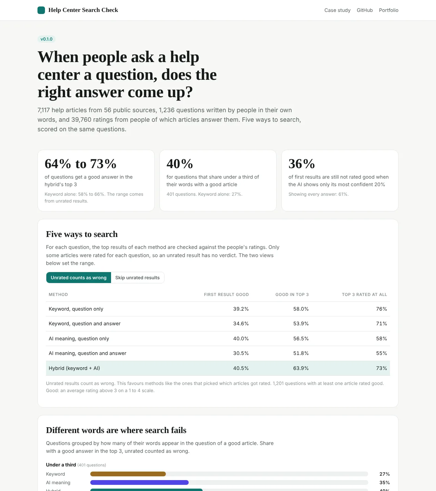

# Help Center Search Check

**When people type a question into a help center, does the right article come up? Keyword search, a local AI model and a hybrid of both, scored on 1,201 questions and 7,117 help articles rated by people.**

**Current version:** 0.1.0

Live results: https://kostasxeras.com/help-center-search-check/



## Why this exists

A help center that shows the wrong article sends people to support anyway. Teams usually ask "should we add AI search?". The more useful questions are where search fails today, whether AI fixes those cases, and whether a score can tell when to say "no good answer".

## What it does

- Uses COUGH: 7,117 English FAQ items from 56 public sources (government health sites, the WHO, US states, WikiHow and others), 1,236 questions written by people in their own words, and 39,760 ratings from people of which articles answer which question.
- Runs five searches for every question: keyword search on the article question only, keyword search on question and answer, a local AI model on each of those, and a hybrid of keyword and AI.
- Scores the first result and the top 3 against the ratings, in two views: unrated results counted as wrong, and unrated results skipped.
- Groups questions by how many words they share with a good article, and tests whether the top score can decide when to show "no good answer".

## Main findings

Full detail in the [case study](docs/case-study.md).

| Method | Good in top 3 (unrated = wrong) | Good in top 3 (unrated skipped) | Top 3 rated at all |
|---|---|---|---|
| Keyword, question only | 58.0% | 66.0% | 76% |
| Keyword, question and answer | 53.9% | 63.5% | 71% |
| AI meaning, question only | 56.5% | 71.3% | 58% |
| AI meaning, question and answer | 51.8% | 67.8% | 55% |
| Hybrid (keyword + AI) | 63.9% | 73.1% | 73% |

- **The hybrid finds a good answer most often in both views:** 64% to 73% of questions get one in the top 3, against 58% to 66% for keyword search alone.
- **Search the article question, not the whole article.** Adding the answer text made both keyword and AI search worse, in both views.
- **Different wording is where search fails.** 401 questions share under a third of their words with any good article. Keyword search gets a good top 3 for 27% of them, the hybrid for 40%.
- **The score can't tell when to say "no good answer".** Showing only the AI's most confident 20% of first results still leaves 36% not rated good. The 35 questions with no good-rated article score slightly higher than the rest.
- **The test set favours the methods that built it.** Only 58% of the AI model's top 3 results were rated at all, against 76% for keyword search. Whether AI beats keyword search on its own depends on how unrated results are counted.

## Data

[COUGH](https://github.com/sunlab-osu/covid-faq) by Zhang, Sun, Yue, Lin and Sun (EMNLP 2021), licensed CC BY-NC-SA 4.0 for research and education use. FAQ items come from the [56 sources listed by the authors](https://github.com/sunlab-osu/covid-faq/blob/master/List_of_websites.txt) and date from 2020. The results data in `data/` contains FAQ questions and source names from it and is shared under the same licence.

Two things to know about this data:

- The questions were written by people rewording existing FAQ items, not taken from real search logs.
- People rated about 32 articles per question, picked from the results of the authors' own search systems. Articles outside that pool have no rating.

This project tests search. Nothing on the page is health advice.

## My role

I framed the question, chose the methods and the two scoring views, and wrote the findings. Decisions are recorded in [docs/decisions](docs/decisions).

## Run it yourself

- **Results page:** open `index.html` through any local web server, for example `python3 -m http.server`.
- **Analysis (Python 3 with pandas, numpy, scikit-learn and rank-bm25, Node.js 18+):** `npm install`, `npm run download`, `npm run prepare-data`, `npm run embed`, `npm run export`. The AI step runs on the laptop and takes about 12 minutes. No paid AI calls.

## Repo layout

```
index.html                 Results page
data/results.json          Everything the page shows
scripts/0-... to 4-...     Download, prepare, embed, search, export
docs/methods-output.txt    Raw output of the export step
docs/case-study.md         Question, approach, findings, next steps
docs/product-brief.md      Users, goals, scope
docs/decisions/            One record per real tradeoff
```
